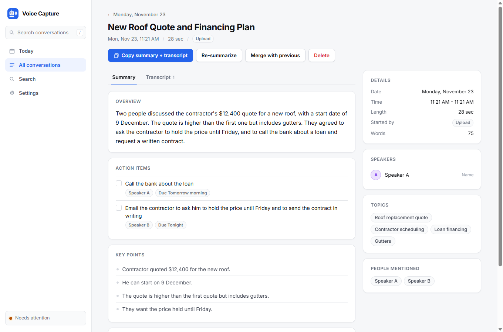
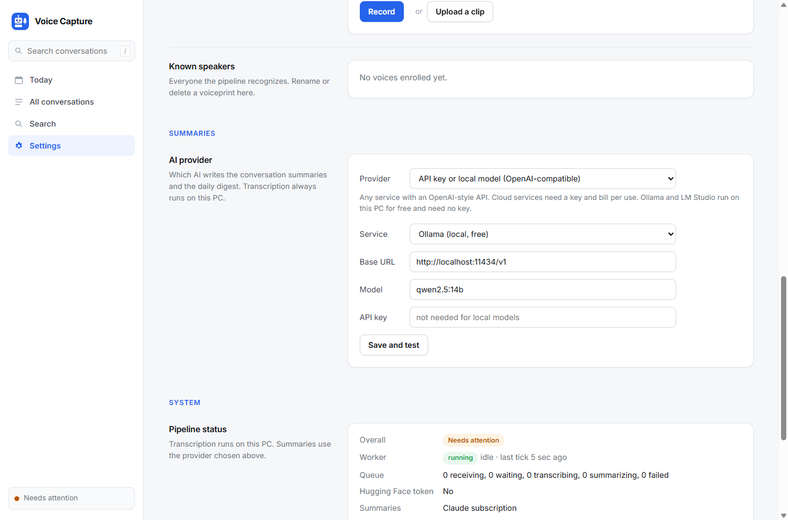

# Voice Capture

Turn a Galaxy Watch (or any Wear OS watch) into a wearable AI note taker, like a Plaud pin, without buying one.

Tap the watch to record a conversation. Your PC transcribes it with speaker names, an AI writes the summary and action items, and the audio is deleted. Everything shows up in a private dashboard on your own computer.



## What you get

- **A watch app.** Record with a button, a watch-face shortcut, or a double press of the Home key. There's also an auto mode that starts recording when it hears speech.
- **Transcripts with speaker labels.** WhisperX runs on your own GPU. Teach it your voice once and it labels you by name. Name other people as they show up.
- **Summaries from the AI you already pay for.** Pick one in Settings:
  - Claude subscription (through Claude Code)
  - ChatGPT subscription (through the Codex CLI)
  - any API key (OpenAI, Gemini, Anthropic, OpenRouter)
  - a free local model (Ollama or LM Studio)
- **A daily digest** of everything you recorded that day.
- **Easy on your PC.** Summarize right away, in one batch at a set time, or only when you ask. It can also wait while you game or render.
- **Keyword search** across every conversation.
- **No audio kept.** The watch deletes each clip once the PC confirms it arrived. The PC deletes the audio once the transcript is saved.



## What you need

| | |
|---|---|
| Watch | Wear OS 3 or newer: Galaxy Watch 4 and later, Pixel Watch. Built and tested on a Galaxy Watch7. No Apple Watch. |
| PC | Windows 10 or 11 with an NVIDIA GPU. Built on a 16 GB card. Smaller cards and CPU-only are untested. |
| Software | Python 3.12, ffmpeg, Android platform-tools (adb) |
| Accounts | A free Hugging Face account (for speaker labels), plus one AI option from the list above |

## Setup

The fastest way is to let a coding agent do it. Open Claude Code or Codex in an empty folder and paste this:

```
Clone https://github.com/alexleveled/watch-voice-capture into this folder and set it up for me.
Follow the AGENTS.md file in the repo step by step, and ask me when you need something from me.
```

Already cloned it? Open the folder and say "Set this up for me."

The agent reads [AGENTS.md](AGENTS.md), installs everything, checks each step, and stops to ask you for the few things only you can do (pairing the watch, the Hugging Face token).

Your keys go in through the dashboard, not a text file. Settings has a box for the Hugging Face token (Voices), the AI provider API key (Summaries) and the optional calendar link (Auto mode). Each one is saved to a local `.env` file on your PC and is never shown again.

To do it by hand, follow [SETUP.md](SETUP.md). Plan on about an hour, most of it downloads.

## How it works

```
Watch app
  mic -> 2 minute Opus clips -> upload queue (kept on the watch while offline)
     |
     v   your home Wi-Fi (default), or a tunnel if you want uploads from anywhere
PC   server.py   receives clips, serves the dashboard and the watch's settings
     worker.py   join clips -> WhisperX transcript -> speaker labels + voiceprints
                 -> delete audio -> AI summary -> daily digest
     |
     v
data/voice.db (SQLite)  ->  dashboard at http://127.0.0.1:8808
```

## Things to know before you rely on it

- **Battery.** Button recording is light. Auto mode keeps the microphone listening and drained a Galaxy Watch7 in a few hours of all-day use. Use auto mode for a busy day or limit it to time windows.
- **The PC has to be on** to receive uploads. The watch holds clips until it is.
- **Wi-Fi mode only uploads at home.** Away from home the watch queues clips and sends them when you're back. Tunnel mode in SETUP.md removes that limit.
- **The watch app is sideloaded** over wireless debugging. It is not in the Play Store.
- **Recording laws.** Many places require everyone's consent before you record a conversation. Auto mode reacts to any voice, including a TV. Know the law where you live and tell people.
- **Summary quality depends on the model.** Small local models can miss details on long conversations. The Settings page has a test button.

## What has and hasn't been tested

Tested: this code was built and used on a Galaxy Watch7 and an RTX 4060 Ti, uploading through a Cloudflare tunnel. In this public version, a Galaxy Watch7 recorded and uploaded over home Wi-Fi with the released watch app, and the PC pipeline, the Claude subscription provider, the Wi-Fi mode network rules and the calendar parser were each tested. The API-key path was tested against a stand-in server. The local-model path was tested on LM Studio with Qwen 3.5 9B (Q4): 10 to 20 seconds per summary with thinking off for conversations up to 30 minutes, about a minute for a 1 hour one. Planted facts were all kept in synthetic 10, 30 and 60 minute transcripts, and 5 of 6 in a 2 hour one. The summary schedule and the busy-PC wait were tested with forced conditions.

Not tested yet: real OpenAI, Gemini and Ollama endpoints, local-model quality on real (not synthetic) long conversations, the busy-PC thresholds against a real game or render, the Codex CLI provider, other watches, CPU-only transcription, and calendar links from Outlook. If one of these works or breaks for you, open an issue.

## License

MIT. See [LICENSE](LICENSE). The watch app bundles the Silero VAD model (MIT).
